

  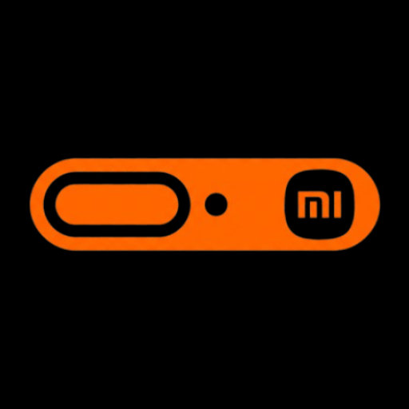

<h1 align="center">Hyper Bridge</h1>

  <strong>Bring the native HyperIsland experience to third-party apps on HyperOS.</strong>

  Hyper Bridge transforms standard Android notifications into Xiaomi HyperOS system-style islands around your camera cutout or status bar. Now featuring a complete dynamic translation engine, visual Widget Studio, community showcase, and adaptive multi-pane layouts for tablets and foldables.

  <a href="https://hyper-bridge.app/"><strong>Official Website</strong></a> •
  <a href="https://hyper-bridge.app/docs/"><strong>Documentation</strong></a> •
  <a href="https://hyper-bridge.app/showcase/"><strong>Community Showcase</strong></a> •
  <a href="https://hyper-bridge.app/changelog/"><strong>Changelog</strong></a>

  

  
  
  
  
  

 

## 🚀 Key Features in 0.6.0

* **🏝️ Native HyperOS Focus Notifications:** Bridges any standard Android app into Xiaomi's native HyperIsland system (on HyperOS 3 known as Featured Notifications).
* **⚡ Dynamic Translation Engine:** Define exactly how notifications are translated into islands with custom rules, regex extractors, and variables.
  * **[10 Official Built-in Templates](https://hyper-bridge.app/docs/features/custom-designs/):** Ready-to-use presets for Navigation, Media, Deliveries, Ride-hailing, File Transfers, Boarding Passes, 2FA/Payments, Queues, Parking, and Couriers.
  * **Smart Extractions:** Automatically detects 4–8 digit OTP codes (`smart_action.OTP.code`), flight and boarding pass details (Flight number, Gate, Seat, Boarding time), and unread message counters.
  * **[Custom Translators (`.htrans`)](https://hyper-bridge.app/docs/customization/custom-translators/):** Build complex, condition-driven rules matching notification titles, content, channels, or progress values.
* **📐 Visual Widget Studio:** A powerful spatial layout editor to design custom micro-widgets rendered directly inside expanded islands.
  * **Canvas & Elements:** Position containers, text blocks, image layers, and progress indicators with interactive live previews.
  * **[Formulas & Variables](https://hyper-bridge.app/docs/widget-studio/custom-widget-formulas-conditions/):** Bind live data tokens like `{notif.title}`, `{media.track}`, `{media.position}`, `{media.remaining}`, `{device.battery}`, and `{time.now}`.
  * **[Packaging (`.hwidget`)](https://hyper-bridge.app/docs/widget-studio/custom-widget-files-packaging/):** Export, import, and share complete micro-widget bundles.
* **💊 Compact Pill Customization:** Granular control over the small pill layout:
  * **Left Slot:** Select graphic source (App Icon, Notification Icon, Sender Avatar, Media Album Art, Custom Theme Icon, or Hidden) and text source (Title, Message, Sender, App Name, Track, Artist, Custom Template, or None).
  * **Right Slot:** Choose between Smart Auto, OTP, Boarding Pass, Progress %, Timer, Message, Sender, Track, Artist, Media Counter, Unread Badge, Highlighted Text, or None.
  * **Media Counter Modes:** Toggle playback display between **Time Elapsed** (`02:45`) and **Time Remaining** (`-01:15`).
* **🎨 Deep Theming & Color Schemes:**
  * **[Theme Creator](https://hyper-bridge.app/docs/customization/theme-creator/):** Customize accent colors, island backgrounds, and button styling.
  * **[Dynamic Color Schemes (`.hscheme`)](https://hyper-bridge.app/docs/customization/custom-widget-color-schemes/):** Define 16-role palettes that automatically tint micro-widgets using album art, app icons, or custom palettes.
  * **Icon Shapes:** Expressive icon clipping with shapes like *Squircle*, *Clover*, *Arch*, and *Cookie*.
* **📱 Adaptive Layout for Tablets & Foldables:**
  * Fully reimagined responsive experience featuring split-pane navigation, cascading panes, and 3-column canvas editors tailored for tablets, foldables, and landscape devices. Learn more in the [Adaptive Screen Guide](https://hyper-bridge.app/docs/getting-started/adaptive-large-screens/).
* **✨ [Community Showcase](https://hyper-bridge.app/showcase/):** Discover, download, and share community-created themes, custom translators, color schemes, and micro-widget designs.
* **⚡ Smart Actions & Quick Replies:** Tap actionable buttons directly from the island (e.g. copy OTP codes, open maps, or perform [Inline Replies](https://hyper-bridge.app/docs/features/inline-reply/)).
* **🔒 System & Hardware Integrations:**
  * [Privileged Shizuku & Sui Support](https://hyper-bridge.app/docs/shizuku/) for enhanced system features.
  * Integrated screen recording controls, charging speed metrics, and VPN status islands.
  * [Spoiler Protection](https://hyper-bridge.app/docs/getting-started/app-settings/) to suppress sensitive terms on the lockscreen or ambient island.

---

## 🌟 Community Showcase

Explore community-created designs or share your own creations on the official **[Hyper Bridge Showcase](https://hyper-bridge.app/showcase/)**:

* 🎨 **[Themes (`.htheme`)](https://hyper-bridge.app/showcase/themes/)**: Custom palettes, button styles, and notification visuals.
* ⚡ **[Translators (`.htrans`)](https://hyper-bridge.app/showcase/translators/)**: Rule packages for specific third-party apps and services.
* 📐 **[Studio Designs (`.hwidget`)](https://hyper-bridge.app/showcase/designs/)**: Custom-crafted micro-widgets for expanded island views.
* 🌈 **[Color Schemes (`.hscheme`)](https://hyper-bridge.app/showcase/schemes/)**: Harmonious color palettes for Studio designs.

Want to publish your design? Check out the **[Showcase Submission Guide](https://hyper-bridge.app/docs/contributing/showcase-submission/)**.

---

## 📚 Documentation & Guides

Comprehensive documentation, tutorials, and specifications are available on **[hyper-bridge.app/docs](https://hyper-bridge.app/docs/)**:

* **[Getting Started](https://hyper-bridge.app/docs/getting-started/):**
  * [Installation Guide](https://hyper-bridge.app/docs/getting-started/installation/)
  * [Permissions & HyperOS Setup](https://hyper-bridge.app/docs/permissions/)
  * [Battery & Autostart Optimization](https://hyper-bridge.app/docs/permissions/battery-and-autostart/)
  * [Large Screens & Foldables](https://hyper-bridge.app/docs/getting-started/adaptive-large-screens/)
* **[Customization & Creation](https://hyper-bridge.app/docs/customization/):**
  * [Design Hub Guide](https://hyper-bridge.app/docs/customization/design-hub/)
  * [Theme Creator](https://hyper-bridge.app/docs/customization/theme-creator/)
  * [Color Schemes Guide](https://hyper-bridge.app/docs/customization/custom-widget-color-schemes/)
  * [Custom Translators Engine](https://hyper-bridge.app/docs/customization/custom-translators/)
* **[Widget Studio](https://hyper-bridge.app/docs/widget-studio/):**
  * [Studio Overview](https://hyper-bridge.app/docs/widget-studio/custom-widget-studio/)
  * [Visual Elements & Canvas](https://hyper-bridge.app/docs/widget-studio/custom-widget-elements/)
  * [Formulas & Conditional Rules](https://hyper-bridge.app/docs/widget-studio/custom-widget-formulas-conditions/)
  * [Packaging Specification](https://hyper-bridge.app/docs/widget-studio/custom-widget-files-packaging/)
* **[Shizuku Integration](https://hyper-bridge.app/docs/shizuku/):**
  * [Setup & Privileged Features](https://hyper-bridge.app/docs/shizuku/shizuku-setup/)
* **[Troubleshooting & FAQ](https://hyper-bridge.app/docs/troubleshooting/):**
  * [Frequently Asked Questions](https://hyper-bridge.app/docs/troubleshooting/faq/)
  * [Diagnostics & Monitoring](https://hyper-bridge.app/docs/troubleshooting/diagnostics/)

---

## 📸 Screenshots

### 📱 Phone

|           Home Screen           |                Active Island                |                   Theme Creator                   |                Widget Picker                |
|:-------------------------------:|:-------------------------------------------:|:-------------------------------------------------:|:-------------------------------------------:|
| 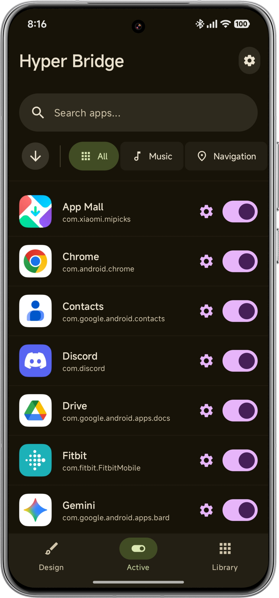 |  | 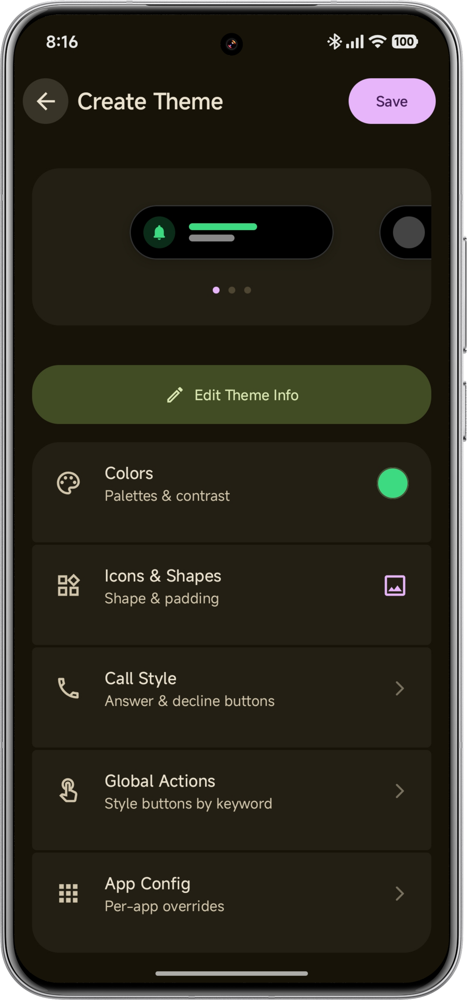 | 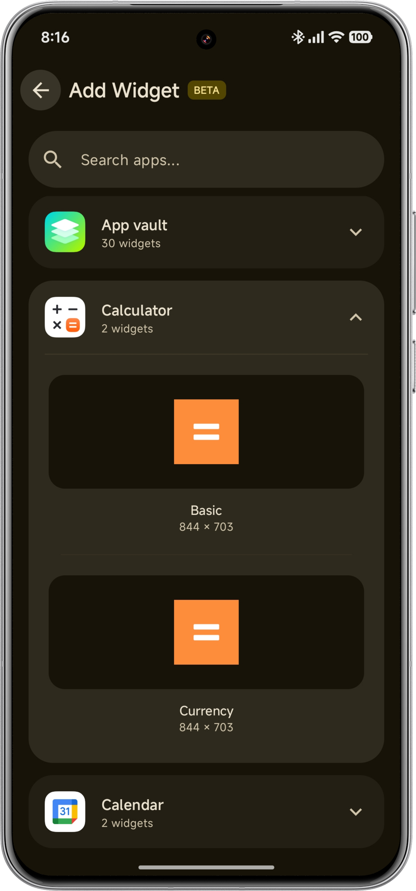 |

|                  Design Screen                   |               Widget Studio                |                     Custom Translator                     |
|:------------------------------------------------:|:------------------------------------------:|:---------------------------------------------------------:|
| 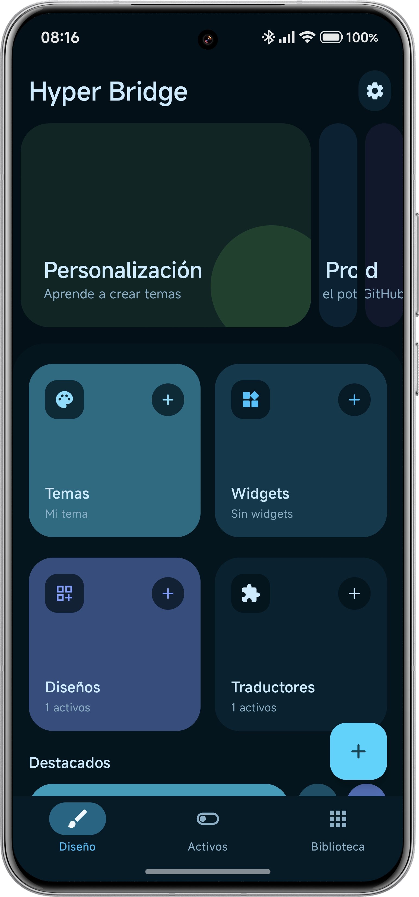 | 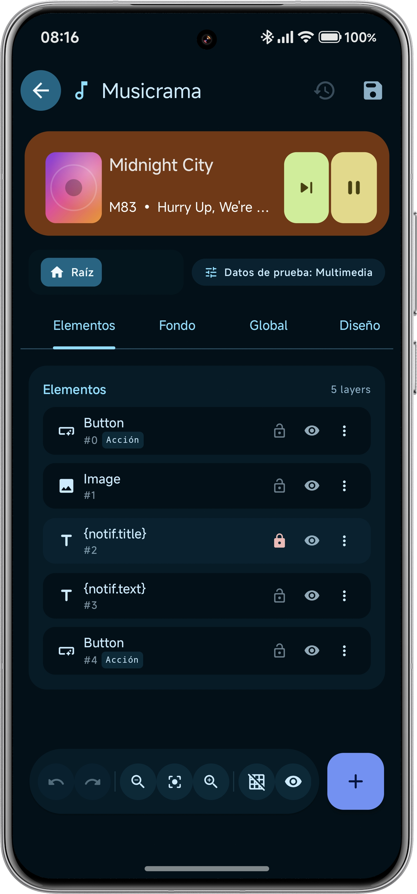 | 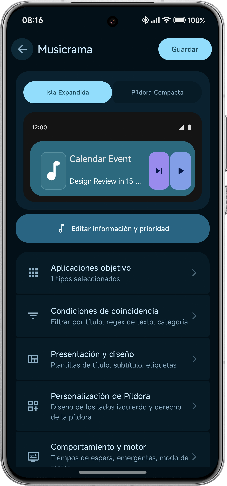 |

### 📟 Tablet & Foldables (Adaptive Multi-Pane)

|             Split-Pane Dashboard              |                Widget Studio (Multi-Pane Canvas)                |
|:---------------------------------------------:|:---------------------------------------------------------------:|
| 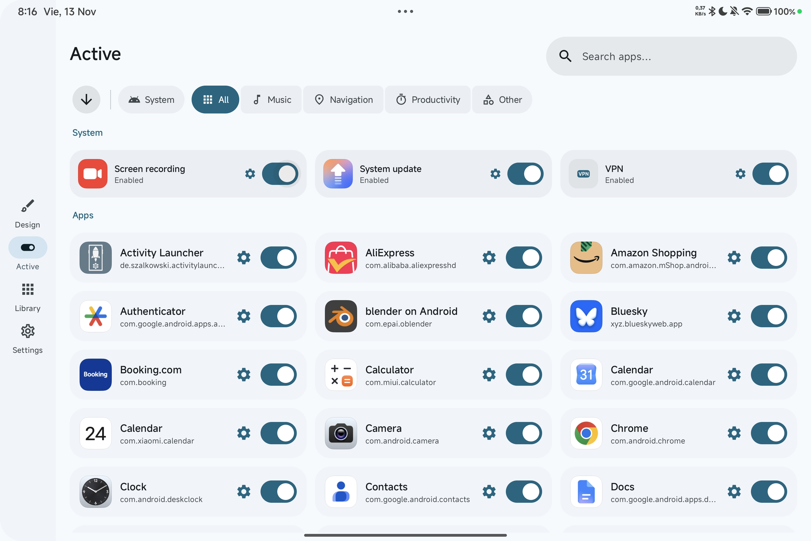 | 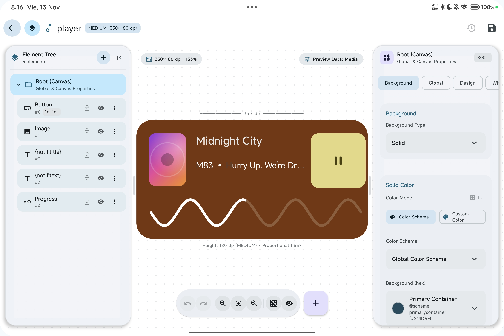 |

|                        Design Hub (Split-View)                        |                         Custom Translator (Split-View)                         |
|:---------------------------------------------------------------------:|:------------------------------------------------------------------------------:|
| 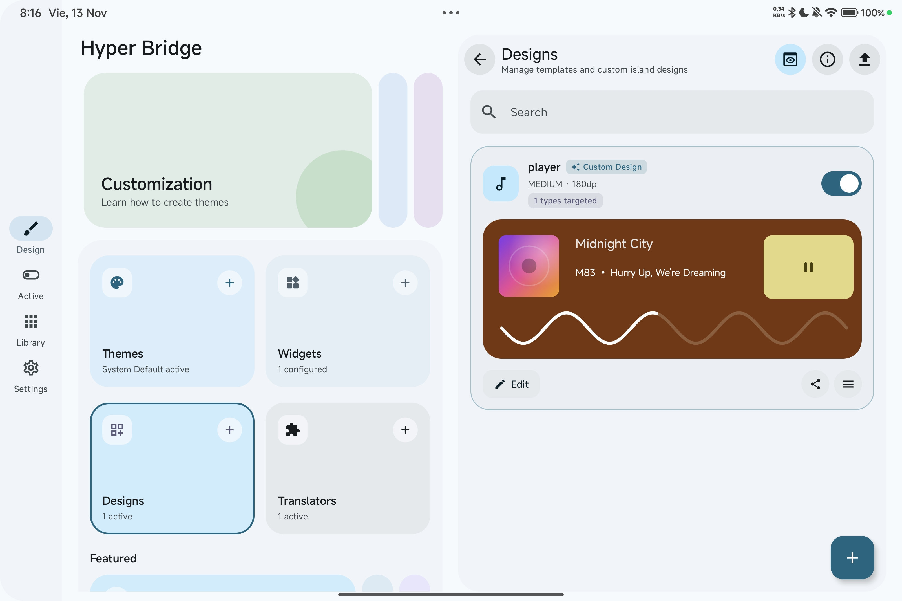 | 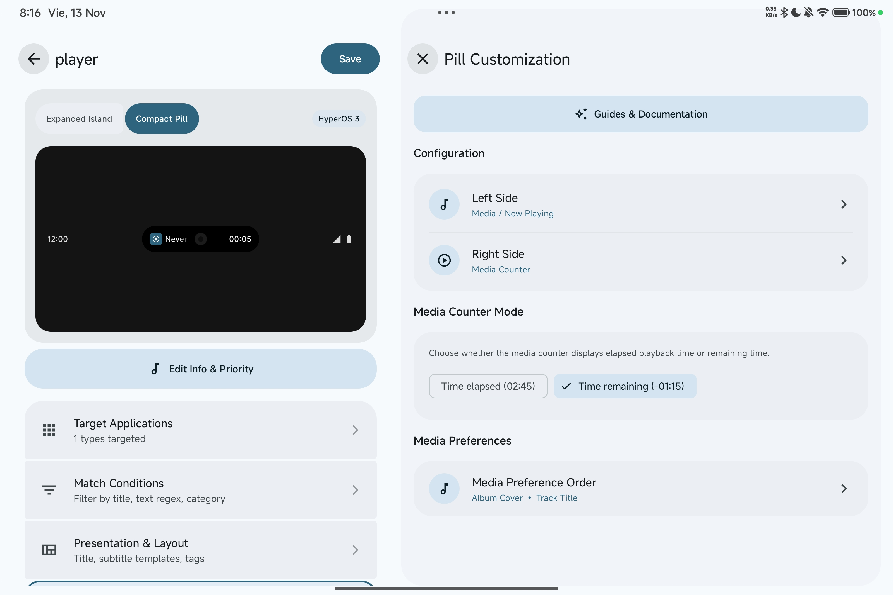 |

|                     Design Screen Overview                      |                               Translator Configuration                                |
|:---------------------------------------------------------------:|:-------------------------------------------------------------------------------------:|
| 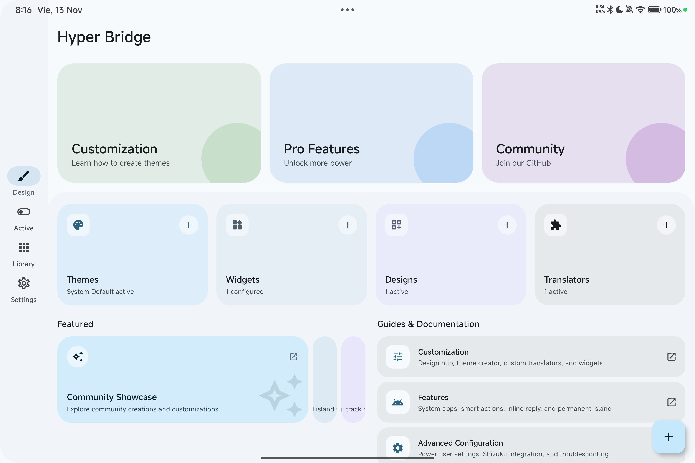 | 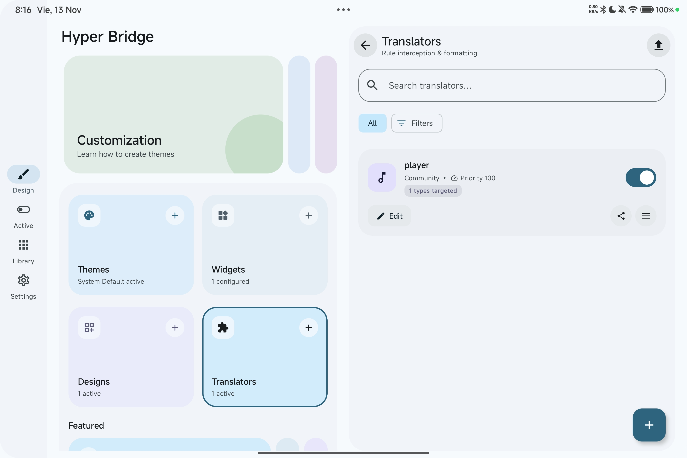 |

|                       App Library                       |                   Adaptive Settings                   |
|:-------------------------------------------------------:|:-----------------------------------------------------:|
| 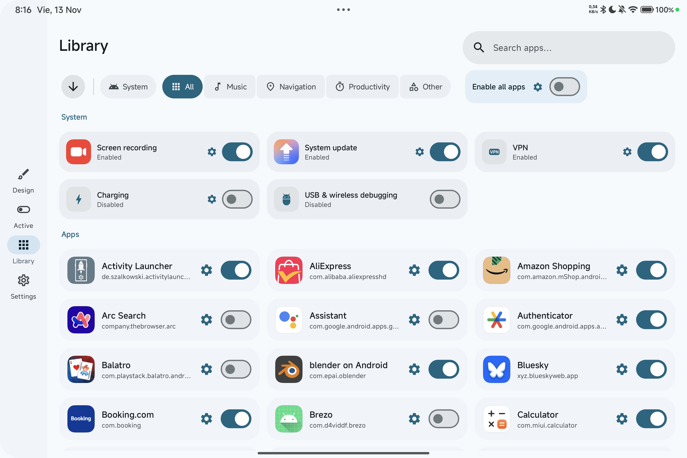 | 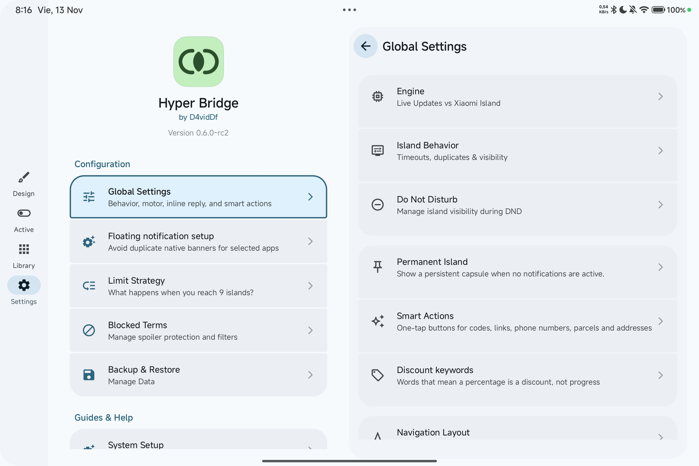 |

---

## 🌐 Supported Languages

HyperBridge is localized into multiple languages by our global community on Crowdin:

👉 **[Help translate HyperBridge on Crowdin](https://crowdin.com/project/hyper-bridge)**

* 🇺🇸 **English** (Default)
* 🇪🇸 **Spanish** (Español)
* 🇧🇷 **Portuguese** (Português Brasileiro) — Thanks to [@NIICKTCHUNS](https://github.com/NIICKTCHUNS)
* 🇵🇱 **Polish** (Polski) — Thanks to [@kacskrz](https://github.com/kacskrz)
* 🇸🇰 **Slovak** (Slovenčina)
* 🇰🇷 **Korean** (한국어) — Thanks to [@alexkoala](https://github.com/alexkoala)
* 🇺🇦 **Ukrainian** (Українська) — Thanks to [@ItzDFPlayer](https://github.com/ItzDFPlayer)
* 🇷🇺 **Russian** (Русский) — Thanks to [@kilo3528](https://github.com/kilo3528)
* 🇩🇪 **German** (Deutsch) — Thanks to [@kilo3528](https://github.com/kilo3528)
* 🇮🇩 **Indonesian** (Bahasa Indonesia)
* 🇹🇷 **Turkish** (Türkçe)
* 🇨🇳 **Chinese Simplified** (简体中文)
* 🇮🇹 **Italian** (Italiano)
* 🇫🇷 **French** (Français)
* 🇭🇺 **Hungarian** (Magyar)
* 🇨🇿 **Czech** (Čeština)

---

## 🌟 Acknowledgements

Special thanks to the following people and projects for their invaluable contributions:

* **[Stardawn](https://www.coolapk1s.com/feed/70418983)**: For the extensive research on the XMSF notification workaround that enables HyperIslands on Chinese ROMs.

---

## 🛠️ Tech Stack

* **Language:** Kotlin
* **UI:** Jetpack Compose (Material 3 Expressive) with Adaptive Navigation (Split-pane / List-detail)
* **Architecture:** MVVM & MVI patterns with unidirectional data flow
* **Local Storage:** Room Database (SQLite), DataStore Preferences
* **Serialization:** Kotlinx Serialization (JSON & ZIP package bundling)
* **System Services:** NotificationListenerService, MediaSessionManager, Accessibility / Overlay Services
* **Concurrency:** Kotlin Coroutines & Asynchronous Flow

---

## 📥 Installation

### Option 1: Google Play Store (Recommended)
The easiest way to install and receive automatic updates.

### Option 2: Manual GitHub APK
1. Download the latest APK from the [Releases](https://github.com/D4vidDf/HyperBridge/releases) page.
2. Install the APK on your Xiaomi / Redmi / POCO device running HyperOS.
3. Open the app and follow the **[Setup Guide](https://hyper-bridge.app/docs/getting-started/first-steps/)** to configure Notification Access, Autostart, and Battery optimization.

---

## 🤝 Contributing

Contributions are always welcome! Whether you are designing themes, writing custom translators, or helping fix bugs:

* Read our **[Contributing Guide](CONTRIBUTING.md)** and **[Showcase Submission Guide](https://hyper-bridge.app/docs/contributing/showcase-submission/)**.
* For localization, join our **[Crowdin Project](https://crowdin.com/project/hyper-bridge)**.
* Check out the [Architecture Documentation](https://hyper-bridge.app/docs/advanced/) to learn more about our modular translator system.

---

## 💖 Support the Project

Hyper Bridge is an open-source project maintained with passion in free time. If Hyper Bridge has enhanced your daily experience on HyperOS, please consider supporting its development:

---

## 📜 License

Distributed under the Apache 2.0 License. See [LICENSE](LICENSE) for more information.

---

## 👤 Developer

**D4vidDf**
* Website: [d4viddf.com](https://d4viddf.com)
* GitHub: [@D4vidDf](https://github.com/D4vidDf)
* App Website: [hyper-bridge.app](https://hyper-bridge.app)
